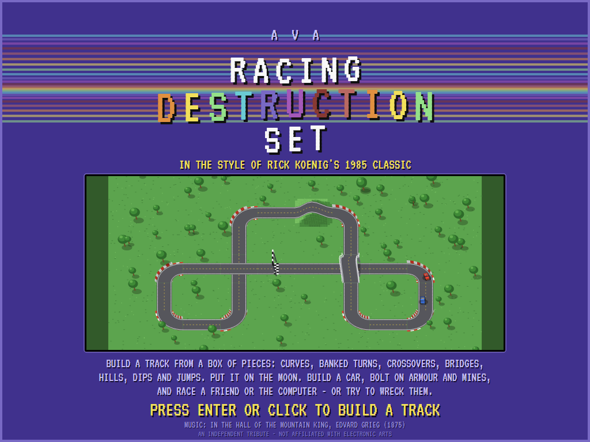
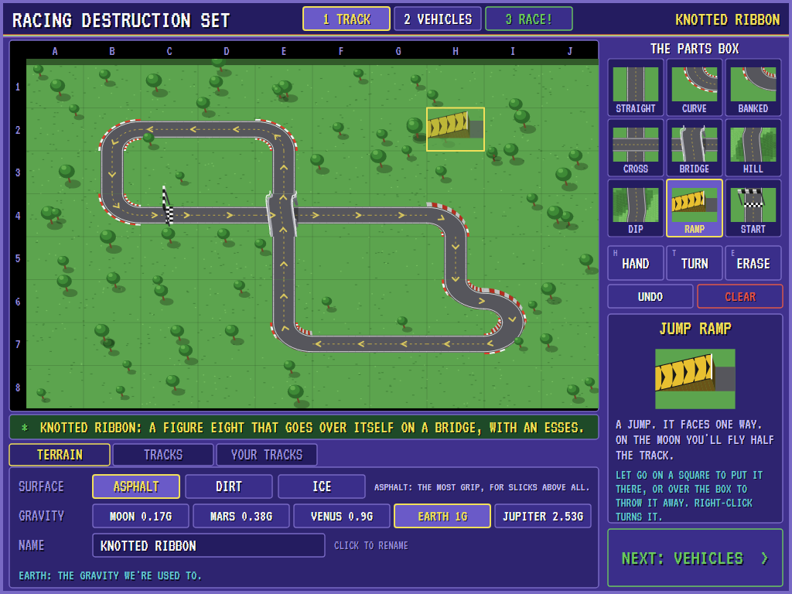
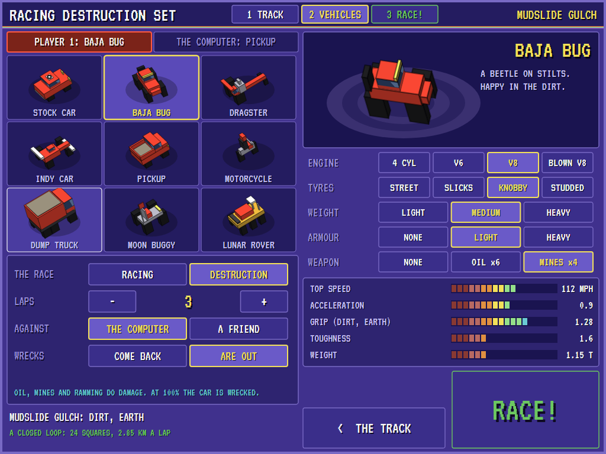
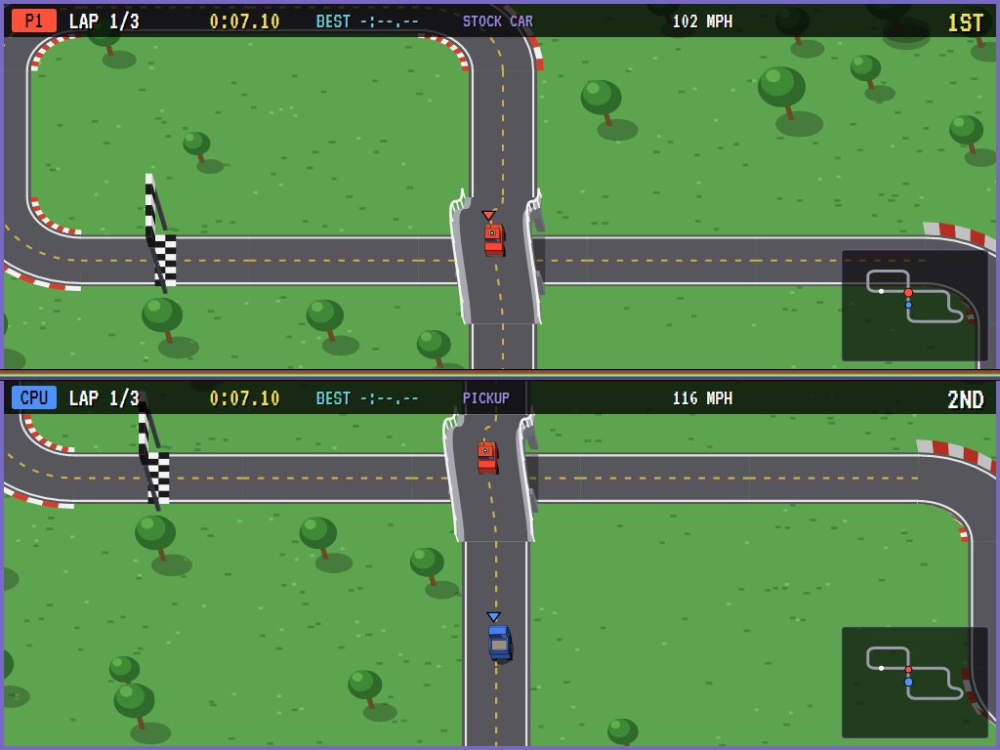
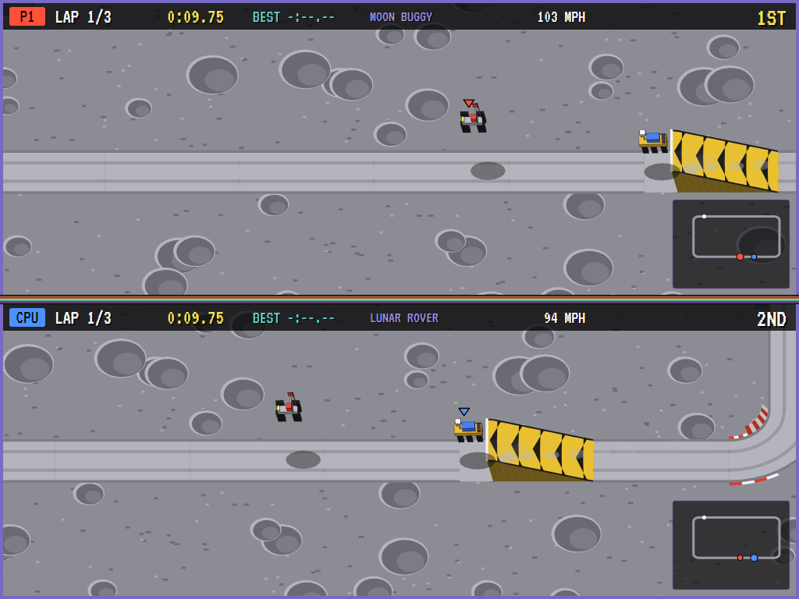
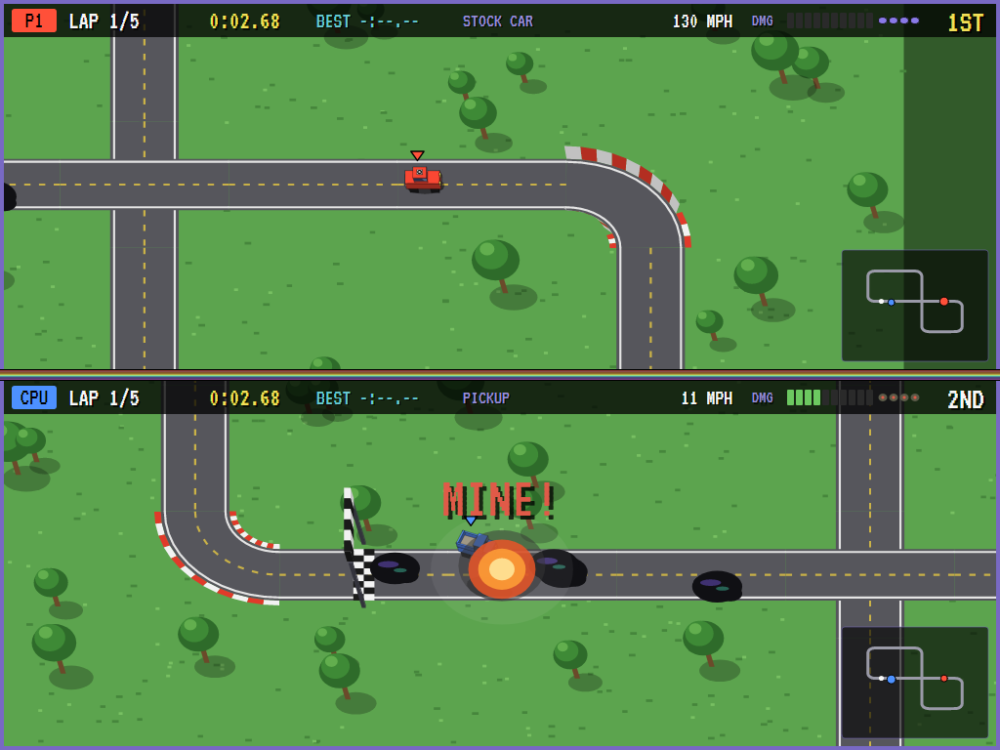
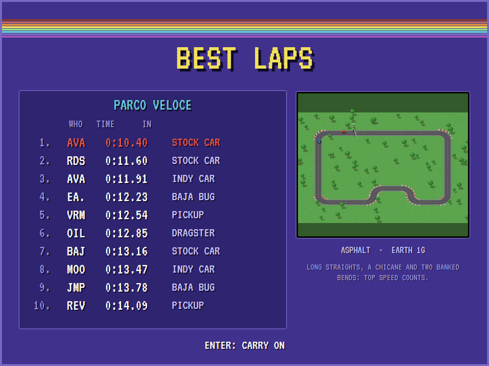

# AVA Racing Destruction Set

[](https://github.com/Harlock123/AVARacingDestructionSet/actions/workflows/build.yml)

A racing construction set in the style of Rick Koenig's 1985 **Racing Destruction Set** (Electronic Arts), built with
.NET 10 and Avalonia UI. Build a track from a box of pieces on a grid seen in the original's 3/4 view: straights,
curves, banked turns, crossovers, bridges, hills, dips and jump ramps. Pave it with asphalt, dirt or ice, and put it on
the Moon, Mars, Venus, Earth or Jupiter. Build a vehicle in the garage: the body, the engine, the tyres, the weight,
armour, and oil or land mines. Then race a friend or the computer on a split screen, in a plain race or a destruction
race where the idea is as much to wreck the other car as to beat it.

## Features

- **The construction set:** a 10 by 8 grid in 3/4 view, the parts box beside it. Drag a piece from the box onto a
  square, or click it in the box and click it down square after square. Drag pieces about with the hand, drag one back
  into the box to throw it away, and turn one with the right button (or R, or the mouse wheel). The turn tool turns,
  the eraser erases, and undo goes back sixty steps.
- **Nine pieces:**
  - **Straight**, **curve** and **banked turn** (it grips half as hard again, so it's taken faster).
  - **Crossover:** two roads across each other, flat. Mind the other car.
  - **Bridge:** one road over the other on a humpback bridge. Cars pass under it; at speed they hop it.
  - **Hill** and **dip:** the ground rises and falls with the road. Fast over a hill and you're in the air.
  - **Jump ramp:** it faces one way. Speed and gravity decide how far you fly.
  - **Start line:** it points the way the race goes.
- **A closed loop or not:** the track is checked after every change, and the bar under the grid says either that
  it's a closed loop and how long a lap is, or exactly what's wrong and where, with the square blinking: *THE ROAD
  STOPS: I5 IS EMPTY*, *BAD JOIN AT D3*, *THE JUMP RAMP AT F2 FACES THE WRONG WAY*, *THE LOOP USES ONLY ONE ROAD
  OF THE CROSSOVER AT E4*. Chevrons along a finished loop show which way it runs.
- **The terrain:** **asphalt**, **dirt** or **ice**, and the gravity of the **Moon** (a sixth of Earth's), **Mars**,
  **Venus**, **Earth** or **Jupiter** (two and a half times). Gravity decides how far a car flies and how hard its
  tyres are pressed onto the road: on the Moon the jumps go on for ever and the bends need care; on Jupiter there's grip
  for days, the jumps are short and the landings hard. Each planet has its own ground: grass and trees, grey dust and
  craters, red rocks, yellow haze, Jupiter's bands.
- **Ten tracks in the box,** all original designs: **Oxbow Oval**, **Figure Eight Fair**, **Knotted Ribbon** (a
  figure eight over itself on a bridge, after a famous Japanese circuit), **Parco Veloce** (long straights and a
  chicane, after a famous Italian one), **Mudslide Gulch** (dirt), **Frostbite Ring** (ice), **Crater Rim** (the
  Moon), **Red Planet Rally** (Mars), **Jupiter Grind** and **Spaghetti Junction** (two crossings and a bridge).
- **The garage:** nine vehicles, each with its own shape and manners: **stock car**, **Baja bug**, **dragster**,
  **Indy car**, **pickup**, **motorcycle**, **dump truck**, **moon buggy** and **lunar rover** (the last two grip
  better in low gravity). Then:
  - **Engine:** 4 cylinder, V6, V8 or blown V8: more top speed and acceleration, and a little more weight.
  - **Tyres:** street, slicks (best on asphalt, hopeless on ice), knobby (best on dirt) or studded (for ice).
  - **Weight:** light, medium or heavy: acceleration traded for toughness.
  - **Armour:** none, light or heavy: keeps out a third or more of every knock, and weighs the car down.
  - **Weapon:** six oil slicks or four land mines.

  The bars show what the build will do on this track's surface and planet.
- **Racing,** one to nine laps, split screen: player 1's car on top, player 2's (or the computer's) below, each half
  following its own car, with the lap, the lap time, the best lap, the place, the speed and a small map. Three red
  lights, then green.
- **Driving:** grip runs out in the bends and the car slides wide, with tyre smoke; off the road the rough slows you,
  and too far off it the tow truck takes you back. A car follows the road over hills and bridges until the road falls
  away faster than gravity can pull it down, then it flies, its shadow on the ground beneath it, and lands, hard if it
  fell far. Cars knock each other about, the lighter one more; at a crossing one can pass under the other.
- **Destruction:** drop **oil** (the next car to hit it loses its grip and spins) or **mines** (armed a moment after
  they're laid; they throw a car into the air and do it real damage). Ramming does damage too. A damage meter fills
  to 100% and the car is wrecked: it burns, and either comes back after a few seconds or, if you choose, is out, and
  the other car has won.
- **Best laps** for each track, with initials and the vehicle, kept between runs.
- **The attract mode:** two computer drivers race the tracks in the box in turn, a plain race and a destruction
  race. The computer aims at a point up the road, keeps to a speed the bends ahead allow with the grip it has there,
  works out how fast it can take each hill, bridge and ramp and still land on the road (on the Moon, not fast), drops
  its weapons on a car close behind and steers round what's been dropped (most of the time).
- **The sounds** are all synthesised: an engine for each vehicle that revs with it, tyre squeal, crashes,
  explosions, oil, mines, jumps and landings, the lights, the chequered flag, the construction set's clicks, and
  the title tune, *In the Hall of the Mountain King*.

## Screenshots

| The title | The construction set | The garage |
|:---------:|:--------------------:|:----------:|
|  |  |  |
| Spaghetti Junction behind the name. | Knotted Ribbon, a ramp on its way from the box. | A Baja bug with knobby tyres and mines. |

| Split screen | A jump on the Moon | Destruction |
|:------------:|:------------------:|:-----------:|
|  |  |  |
| Over the bridge on Knotted Ribbon. | Crater Rim: a sixth of the gravity. | A mine nobody saw, and oil. |

| The best laps |
|:-------------:|
|  |
| Parco Veloce's ten best, a new one at the top. |

The screenshots are made by the tests, which drive the program with the mouse in a real (headless) window; see
[Tests](#tests).

## Download and run

Ready-to-run builds for Windows, macOS and Linux, on both Intel/AMD and ARM, are on the
[Releases page](https://github.com/Harlock123/AVARacingDestructionSet/releases/tag/latest). **Latest build** is
rebuilt on every push to `main`. Each download is one self-contained executable: no .NET install is
needed.

| Platform | Archive |
|---|---|
| Windows | `AVARacingDestructionSet-win-x64.zip`, `AVARacingDestructionSet-win-x86.zip`, `AVARacingDestructionSet-win-arm64.zip` |
| macOS | `AVARacingDestructionSet-osx-arm64.tar.gz` (Apple silicon), `AVARacingDestructionSet-osx-x64.tar.gz` (Intel) |
| Linux | `AVARacingDestructionSet-linux-x64.tar.gz`, `AVARacingDestructionSet-linux-arm64.tar.gz`, `AVARacingDestructionSet-linux-arm.tar.gz` |

```bash
tar -xzf AVARacingDestructionSet-linux-x64.tar.gz     # or linux-arm64, linux-arm, osx-arm64, osx-x64
./AVARacingDestructionSet
```

On Windows, unzip and run `AVARacingDestructionSet.exe`. On macOS, if Gatekeeper refuses to open it, run
`xattr -d com.apple.quarantine AVARacingDestructionSet` once. Run with `--no-audio` for silence.

**Sound** comes through OpenAL Soft, built in for every platform. In a virtual machine the program
detects it and uses a larger audio buffer, so the sound doesn't break up.

**Gamepads** use SDL2, which is bundled for Windows, macOS and Intel/AMD Linux. ARM Linux builds need it
installed; without it the keyboard still works:

```bash
sudo apt install libsdl2-dev            # Debian / Ubuntu / Raspberry Pi OS
sudo pacman -S --needed sdl2-compat     # Arch / Omarchy
```

Saved tracks are in your application-data folder (`~/.config/AVARacingDestructionSet/tracks` on Linux,
`%APPDATA%\AVARacingDestructionSet\tracks` on Windows), with the best laps beside them.

## Controls

**Building** a track is done with the mouse:

| Action | Mouse | Keyboard |
|---|---|---|
| Put a piece on the grid | Drag it from the parts box | |
| Put down several of a piece | Click it in the box, then click squares | Esc puts it back |
| Move a piece | Drag it with the hand | |
| Throw a piece away | Drag it back into the box, or click it with the eraser | Delete (the piece chosen) |
| Turn a piece (in the hand or on the grid) | Right-click, or the mouse wheel | R |
| Choose a tool | Click it | H hand, T turn, E eraser |
| Undo | The undo button | Ctrl+Z |
| Panels | Terrain, Tracks, Your tracks | Tab |
| On to the garage | NEXT: VEHICLES | Enter |
| Back to the title | | Esc |

**The garage** is mouse too: click a vehicle and its parts, the race's settings, and RACE! (or Enter). Left and right
(or the wheel) step through the vehicles; Tab switches between the two players' vehicles; Esc goes back to the track.

**Racing:**

| Action | Player 1 | Player 2 | Gamepad (first for player 1, second for player 2) |
|---|---|---|---|
| Steer | Left and right arrows | A and D | Left stick / D-pad |
| Gas | Up arrow | W | A, right trigger or up |
| Brake (and reverse) | Down arrow | S | B, left trigger or down |
| Drop oil or a mine | Right Ctrl or Enter | Left Shift or Space | X, Y or a shoulder button |
| Pause | P or Esc (Esc again: back to the garage) | | Start / Back |
| Sound on/off | M | | |
| Screenshot | Ctrl+S (to your Pictures folder) | | |

On the best laps, type your initials, or use up/down and Space, then Enter.

## Tests

```bash
dotnet test AVARacingDestructionSet.slnx
```

The race runs in fixed 60 Hz steps, so it plays the same at any frame rate, and everything in it that moves or
changes lives in one world that can be copied. The tests check:

- **Tracks:** a closed loop and its length, starting on the start line; an empty grid; no start line and two; a gap
  in the road, a bad join, the road running off the grid, a ramp facing the wrong way, a piece not on the loop and a
  crossing used only one way, each named with its square; the ten tracks in the box all closed loops, using every
  piece between them; a figure eight crossing itself both ways.
- **Every piece:** each road of each piece turned every way runs edge middle to edge middle, as long as it should be,
  level at both ends and inside its square; curves are true quarter circles; which pieces turn which ways; the heights
  of hills, dips, ramps and bridges (high enough to drive under); the road's exact height under a car; over and under
  a bridge, each road found from its own height; a car driven across a straight, a hill, a dip and a ramp staying on
  the road.
- **The physics:** the gas, the brake, coasting and the rough; steering; grip holding a car in a bend until it runs
  out (and banking holding it longer); every surface and set of tyres; gravity's grip and acceleration on every planet;
  the tow truck; ramp jumps flying longer the lower the gravity (about as one over it), and the course predicting
  where a jump comes down just as the race has it; hills thrown off at speed on Earth and at any speed on the Moon,
  but not on Jupiter; hard landings; driving off a bridge.
- **The garage:** nine different vehicles; engines, ballast and armour doing what they say; ammunition; a bigger
  engine pulling away; the computer's choices for each track.
- **Destruction:** oil dropped one at a time behind the car and spinning the next car; no weapons in a plain race;
  mines blowing up under the other car, and waiting before they can catch the car that laid them; armour and
  toughness; ramming hurting the lighter car more, and not at all in a plain race; cars at different heights passing
  through each other; a wreck coming back mended; a wreck ending the race when wrecked cars are out.
- **The race:** the grid and the lights; laps, lap times, the finish, the late timer and the standings; a short cut
  not counting; each player's own controls; a copied world going on exactly as the original.
- **The computer driver:** both cars home on every one of the ten tracks without a tow, quicker than a new track's
  made-up best laps; destruction races finished; a driver holding the gas down never finishing a lap; slowing for a
  jump on the Moon, braking earlier on ice, dropping a weapon on a car close behind.
- **Files:** every piece turned every way, the surface and the planet coming back from a file exactly; every track in
  the box round-tripping; readable JSON; broken, foreign and hand-edited files; saving, listing and opening tracks.
- **The construction set and the program:** pieces from the box, stamping, the hand, turning, erasing, the keys,
  clear, the terrain, undo sixty deep, a track built square by square; the title, the demonstration and the best
  laps; Enter through the stages; a broken track refused; the garage's builds in the race, and a friend or the
  computer; records and initials, kept per track; pause; the track kept on disk; the engines revving.
- **The keys and the window:** each player's keys (Up through the keys drives the car forward, Right turns it
  clockwise), the Shift that comes up as CapsLock; and in a real (headless) window, the mouse dragging and stamping
  pieces, the tool keys and buttons, the terrain, typing a name, the tracks panels, the garage, two players' keys,
  pause, mute, and every screen drawing.

`tests/AVARacingDestructionSet.Tests/PilotProbe.cs` reports how the computer drivers get on, track by track, for
tuning (`RDS_PROBE=1` for plain races, `RDS_PROBE=destruction`, `RDS_PROBE=lazy` for a car that holds the gas down):

```bash
RDS_PROBE=1 dotnet test tests/AVARacingDestructionSet.Tests --filter PilotProbe --logger "console;verbosity=detailed"
```

The screenshot tests draw the real screen in a headless window. To refresh the README's pictures:

```bash
RDS_SHOTS=$PWD/Images dotnet test tests/AVARacingDestructionSet.Tests --filter ScreenshotTests
```

## Building

```bash
dotnet build AVARacingDestructionSet.slnx
dotnet run --project src/AVARacingDestructionSet
```

Needs the .NET 10 SDK. The sounds are made by `tools/make_sounds.py` (standard-library Python):
`python3 tools/make_sounds.py` rewrites `src/AVARacingDestructionSet/Sounds`.

## Track files

A track is saved as `<name>.rds.json` (shortened here; the real file is indented one value to a line):

```json
{
  "format": "AVARacingDestructionSet track",
  "version": 1,
  "track": {
    "name": "OXBOW OVAL",
    "surface": "Asphalt",
    "planet": "Earth",
    "pieces": [
      { "kind": "Start", "col": 4, "row": 1, "rot": 1 },
      { "kind": "Straight", "col": 5, "row": 1, "rot": 1 },
      { "kind": "Banked", "col": 8, "row": 1, "rot": 2 },
      { "kind": "Hill", "col": 5, "row": 6, "rot": 1 },
      ...
    ]
  }
}
```

Columns run 0 to 9 (A to J on the screen) and rows 0 to 7 (1 to 8). `rot` is how many quarter turns clockwise the
piece is given: unturned, a straight, hill, dip or bridge's upper road runs north to south, a curve joins north to
east, and a ramp or the start line is crossed going north. `surface` is `Asphalt`, `Dirt` or `Ice`; `planet` is
`Moon`, `Mars`, `Venus`, `Earth` or `Jupiter`. A file edited by hand is put right when it's loaded: pieces off the
grid are dropped, one piece is kept to a square, and turns are brought into range.

## Project structure

```
AVARacingDestructionSet/
├── AVARacingDestructionSet.slnx
├── src/AVARacingDestructionSet/
│   ├── Engine/
│   │   ├── GameEngine.cs        # States: the title, the demonstration, building, the garage, racing, best laps
│   │   ├── Editor.cs            # The construction set: the parts box, the tools, the terrain, undo
│   │   ├── Track.cs             # Pieces and their roads, tracks, and their JSON files
│   │   ├── Course.cs            # A track checked for a closed loop and laid out for racing: heights, bends, jumps
│   │   ├── Tracks.cs            # The ten tracks in the box, each laid by driving round it
│   │   ├── Vehicles.cs          # The nine vehicles, and what engines, tyres, weight and armour do
│   │   ├── World.cs             # A race in progress, kept so it can be copied
│   │   ├── Sim.cs               # Driving, grip, gravity, flying and landing, oil, mines, damage, laps
│   │   ├── Pilot.cs             # The computer driver
│   │   ├── Geometry.cs          # Vectors, headings, and a copyable random number generator
│   │   ├── BestLapTable.cs, InitialsEntry.cs
│   │   ├── InputHandler.cs, ControllerManager.cs  # Two players' keys and two SDL2 gamepads
│   │   └── SoundManager.cs      # Effects, the title tune and the two engines through OpenAL
│   ├── Audio/                   # The OpenAL engine (from the author's AVABand)
│   ├── Views/                   # The 3/4 view and every piece and vehicle in it, the construction set, the garage, the split screen
│   └── Sounds/                  # The synthesised effects, engines and tune
├── tests/AVARacingDestructionSet.Tests/  # Track, piece, physics, vehicle, weapon, race, pilot, file, editor, game, UI and screenshot tests
├── tools/make_sounds.py
└── Images/                      # Screenshots
```

## About and licence

AVA Racing Destruction Set © 2026 Lonnie Watson, under the [MIT License](LICENSE).

The title tune is the opening theme of *In the Hall of the Mountain King* from Edvard Grieg's music for *Peer Gynt*
(1875), which is in the public domain; this arrangement and its synthesis are the program's own.

*Racing Destruction Set* © 1985 Electronic Arts; the name belongs to its current owner. AVA Racing Destruction Set
is an independent, unofficial program in its style. Its tracks, pieces, vehicles, graphics, sounds and code are its
own; nothing is taken from the original's program, graphics, sound or tracks. It is not affiliated with or endorsed
by Electronic Arts or any rights holder.
